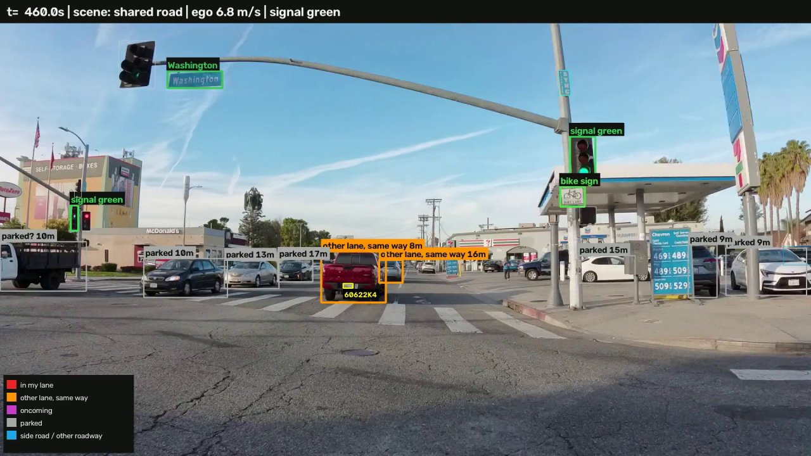
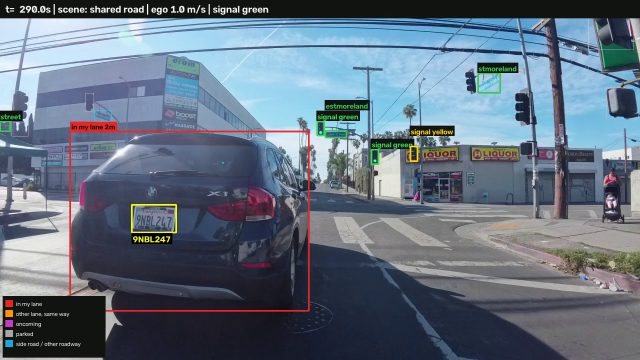
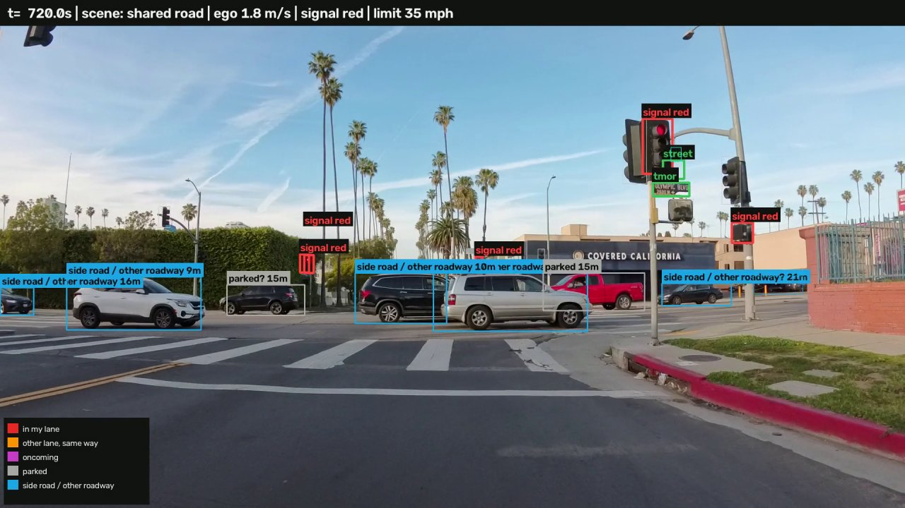

# Bike-route vehicle typology

From a handlebar camera video, finds every vehicle and how it relates to the rider - **in my lane**, **other lane,
same way**, **oncoming**, **parked**, **side road / crossing** - plus the riding context, traffic signals, traffic
signs (typed and read), licence plates, and events such as overtakes, close passes and red-light waits.

**[Watch the demos, see the exposure map and try the review page](https://robertn02.github.io/Car-detection/)** - in
the browser, nothing to install.

## Try it on your video

[](https://colab.research.google.com/github/Robertn02/Car-detection/blob/main/scripts/colab_try_your_video.ipynb)

Nothing to install - it runs in Google Colab with a free GPU:

1. Click **Open in Colab**, then **Runtime > Run all**.
2. Allow Google Drive access, then pick your video (or give its Drive path in the first cell).
3. Scroll down: the overlay clip and the results tables appear at the end, and are saved to
   `My Drive/bikesafe_runs/`.

About 25 minutes for a 3-minute clip (the default) on the free T4, 15 with Colab Pro's L4; set `MINUTES = 0` for the
whole video (a 20-minute ride takes about 1.5 hours on an L4).

## Demos

| Painted bike lane | Following a car from a red light | Parked rows, then a red light |
| --- | --- | --- |
| [](https://robertn02.github.io/Car-detection/#overlay_006_bikelane_440s) | [](https://robertn02.github.io/Car-detection/#overlay_005_following_280s) | [](https://robertn02.github.io/Car-detection/#overlay_006_parked_700s) |

Click a picture to play the clip (60 s, the camera's full size and frame rate). Box colours: red in my lane, orange
other lane, magenta oncoming, grey parked, blue side road.

## Outputs

Per ride, in [`results/corpus/`](results/corpus) ([every column explained](docs/OUTPUTS.md)):

| File | One row per | Start here for |
| --- | --- | --- |
| `vehicles.csv` | vehicle | relation, how close it came, plate, what to double-check |
| `timeline_1s.csv` | second | riding context, speed, traffic in view, signal, signs (local time, joins to GPS) |
| `signs.csv` | sign or signal | sign type and text, posted speed limit |
| `events.csv` | event | overtakes, close passes, crossing traffic, stop signs, red-light waits |
| `gps_1s.csv` | second | where the rider was, from the Strava track (`python -m bikesafe.gps --strava <export>`) |

## Results

Six rides, 112 minutes ([details and limitations](docs/TYPOLOGY_PIPELINE.md)):

| Measure | Value |
| --- | --- |
| Relation right, vehicles within 15 m | 73% (77% within 5 m) |
| Vehicles at a stop called parked | under 4% |
| Riding context right | 89% |
| Signs typed (seen at least 40 px tall) | 61% |
| Plates read (daytime tracks) | 12-16% |

## Review and correct

```bash
python -m bikesafe.review      # open http://127.0.0.1:8765
```

Shows the model's answers - vehicles, signs, plates - most likely errors first. Confirm or correct with one key;
"Retrain" learns from the corrections. In Colab, the notebook's last cell opens it.

A copy that needs no server is on the [project page](https://robertn02.github.io/Car-detection/review/): decisions made there stay in the browser until
downloaded (Progress tab); `python -m bikesafe.review --import decisions.json` adds them to the labels.
Decisions made in Colab are saved with the run on Drive; `python -m bikesafe.review --import "<run folder>"` adds the
run and its decisions here, then Retrain.

## Run locally

Needs an NVIDIA GPU:

```bash
pip install -r requirements.txt
python -m bikesafe.run videos            # every stage, resumable; tables in results/corpus/
python -m bikesafe.render <video> --start-s 300 --duration-s 60   # an overlay clip
```

- Videos stored elsewhere (e.g. Google Drive): set `BIKESAFE_VIDEOS` to their folder.
- Slow GPU: `scripts/colab_bundle.py` sends the slowest stage to Colab. Whole corpus: `scripts/carc_run.slurm` (USC CARC).
- Tests: `python -m pytest tests`.

## Repository

| Folder | Contents |
| --- | --- |
| `bikesafe/` | the pipeline (`run.py` runs every stage) |
| `docs/` | how it works, accuracy, limitations, output columns |
| `results/` | per-ride tables and model evaluation |
| `demos/` | demo posters; the clips and the review copy are on the `gh-pages` branch (`scripts/build_site.py`) |
| `data/typology/` | labels ([labelling guide](data/typology/LABELING_GUIDE.md)) |
| `models/` | detectors and trained models |
| `scripts/` | Colab notebooks, CARC job, evaluation, report builder |
| `reports/` | milestone reports |

The ride videos (21 GB) are kept in Google Drive, available on request. Licence plates are read as plain text and are
public in `results/`.
